  

### 📝 Latest Zenn Articles

<!-- ZENN-POSTS:START -->
- `2026-01-27` [LazyGit × Geminiでターミナル環境でもコミットメッセージを自動生成！](https://zenn.dev/nalt/articles/lazygit-gemini)
- `2026-01-19` [WSL2のGemini CLIにクリップボードの画像を渡す方法](https://zenn.dev/nalt/articles/wsl-gemini-cli-clipboard)
- `2026-01-17` [Neovimデビューしたい人必見！｜Neovim公式チュートリアルを日本語でやる方法](https://zenn.dev/nalt/articles/neovim-official-tutorial-japanese)
<!-- ZENN-POSTS:END -->

🔗 [Zenn (@nalt)](https://zenn.dev/nalt) | [X (@nalt_dev)](https://x.com/nalt_dev)

<!--
profile.json を編集してから、SVGを再生成してください:

python3 scripts/generate_terminal.py

配色は普段使っている WezTerm / Starship / Kanagawa Dragon の設定
(nix-config リポジトリ) から抽出しています。
-->
